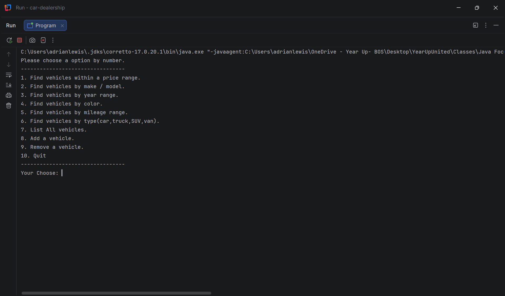
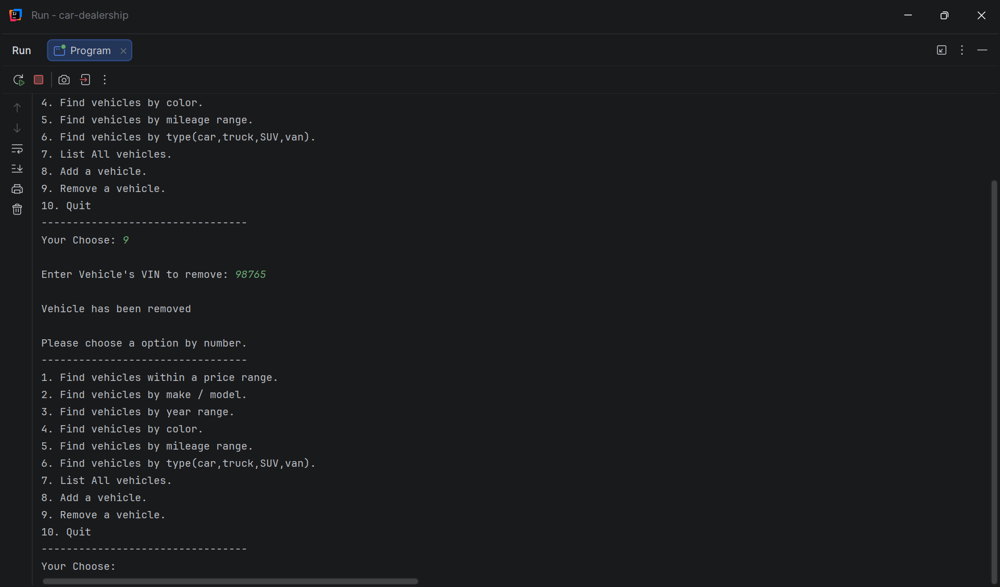
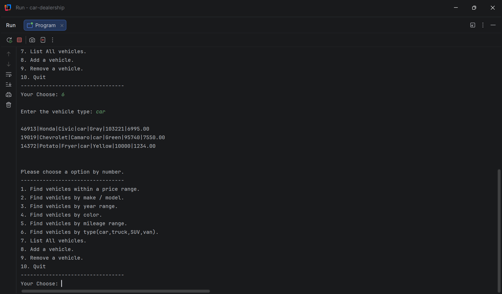

# Dealership Management App

<!-- HOW TO USE THIS TEMPLATE
     Save it as README.md at the root of your project, next to pom.xml. Replace every comment like this one
     with your own text; comments do not show on GitHub, so what you leave untouched shows as an empty heading.
     Two sections are optional and say so: Class Diagram, and Data and configuration. When your project does not
     need one, delete the whole section, heading included. Every other section stays. -->

<!-- One sentence under the title: what the app is, for whom.
     Example: A console app that keeps a store's inventory in a csv file and lets a clerk search it. -->
A console app that keeps a car dealership's vehicle inventory in  a CSV file and lets users search for them.

## Description of the Project

<!-- Three to five sentences. What the application does, who uses it, what problem it solves.
     Write it for someone who has never seen the workbook: a recruiter, a classmate, you in six months. -->
This application allows users to search for specific vehicles in the dealership's inventory using information about the vehicles.
Each vehicle has eight sections that users can enter to find the car for them. This can help employees search through their inventory faster, and lets them add or remove vehicles to updated their inventory.

## Features

<!-- One bullet per thing the app can do, in the order of your menu. Mark bonuses.
     For an API (Capstone 3), one line per endpoint instead: method, path, what it does.
     Be honest: list what works. If something is half done, say so under Future Work instead.
     Example:
     - Shows every product in the store
     - Searches products by name (bonus) -->

- search by type
- add or remove vehicles
- show all vehicles

## User Stories

<!-- The stories you worked from, one per bullet, in the format you learned in Workbook 3b:
     As a [type of user], I want [some goal] so that [some reason].
     Same text as the cards on your GitHub project board. -->

- As a owner, I want to search through my inventory, so that I see all the vehicles in my dealership
- As a owner, I want to add or remove vehicles, so that I can update my inventory

## Setup

### Prerequisites

- Java 17 (Amazon Corretto), the version used in class.
- IntelliJ IDEA Community Edition: <https://www.jetbrains.com/idea/download/>

### Running the application

1. Clone this repository, or download it as a zip and unzip it.
2. In IntelliJ: File > Open, pick the project folder (the one that holds `pom.xml`), press Open.
3. Wait for IntelliJ to finish indexing (progress bar at the bottom).
4. Open `src/main/java/com/pluralsight/YourMainClassName.java`. <!-- replace YourMainClassName with the class that has main -->
5. Right-click inside the file and choose Run 'YourMainClassName.main()'.

## Technologies Used

- Java 17
- IntelliJ IDEA
<!-- Add anything else you used: a library, Maven plugins, an external tool. For a console app this list is short. That is fine. -->

## Demo

<!-- Pictures of the app running: the console for a console app, Insomnia or Swagger for an API.
     Screenshots are enough; a GIF is a bonus.
     1. Create a folder named `images` at the project root, next to `pom.xml`.
     2. Take screenshots of the app in the IntelliJ console (the menu, one feature, one error message):
          Windows: Win + Shift + S, drag a rectangle, then paste into Paint and save as PNG, or open the
                   notification and save. Save into the `images` folder.
          Mac:     Shift + Cmd + 4, drag a rectangle. The file lands on the Desktop; move it into `images`.
     3. Name the files by what they show: `images/menu.png`, `images/search.png`.
     4. Reference each one below with a relative path. No spaces in file names.
     5. Commit the images with the rest of your work (Git > Commit shows them as unversioned files: tick them).
     Optional GIF: LICEcap (free, Windows and Mac, <https://www.cockos.com/licecap/>) records a region of the
     screen straight to a .gif. Keep it under 10 seconds and under 10 MB, save it into `images`. -->







## A piece of code I am proud of

<!-- Paste one short block of your own code (5 to 15 lines) between the three backticks, then write two
     or three sentences: what it does and why you chose to write it that way. This is what you show on
     demo day and what you talk about in an interview. -->

```java
 public static void removeVehicles(int vehicle){
        
        try {
            Dealership dealership = DealershipFileManager.getDealership();

            // Remove vehicle from inventory if VIN matches
            inventory.removeIf(vehicle1 -> vehicle1.getVin() == vehicle);

            // add back the header and vehicles after rewrite
            DealershipFileManager.saveDealership(dealership);

        } catch (Exception e) {
            System.out.println("ERROR: " + e.getMessage());
        }
    }
```
This code is a method for removing a vehicle from the inventory and CSV file. At first, I write it to rewrite the file after clearing it, but changed it when I noticed my mistake. 
I choose to rewrite it this way, so method get the dealership then clear the file, and start the file with its header.
## Future Work

<!-- What you would add or fix next, one bullet each. Unfinished bonuses belong here. -->

- add a way for users to find vehicles by only entering make or model
- add a second switch statement to concise the number of options in home screen

## Resources

<!-- What helped you: the workbook, the week's hub pages, a tutorial, a documentation page. Real links. -->

- Java YearUp Fall 2026 hub: <https://raymaroun.github.io/yearup-java-fall2026/>
- AI agent for Research: <https://copilot.cloud.microsoft/chat/agent/T_20b53e3f-d488-d128-27fc-440ed32e7a02.eade2051-4773-4cb0-aa3e-b17cdf11ebd4.gpt.17fde386-a7a1-4dd0-a089-a0b0a70bb567?fromcode=cmmu8qodiz1&lhredirected=1&es=AutoSignIn>

## Author

<!-- Your name and, if you like, your GitHub profile link. For a team workshop, one line per person with what each one built. -->

- **Adrian Lewis**

## Thanks

<!-- Optional. The people who helped: the instructor, a classmate who debugged with you, a mentor. -->

- Thank you to Raymond for the resource in GitHub